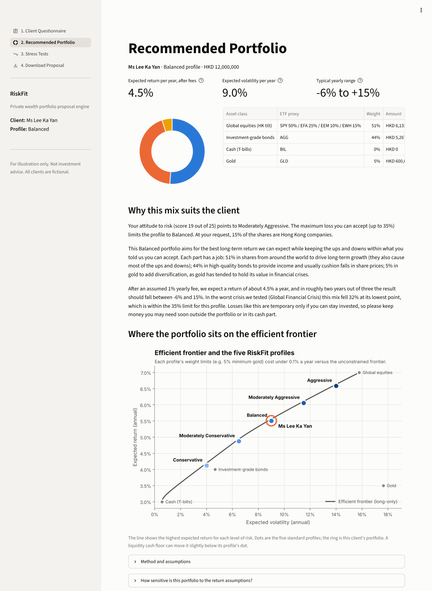
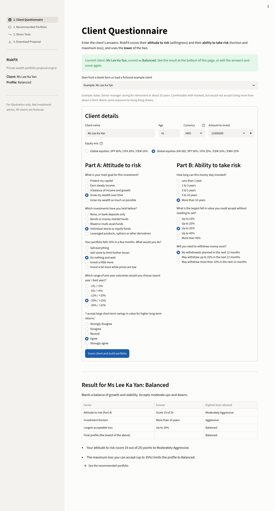
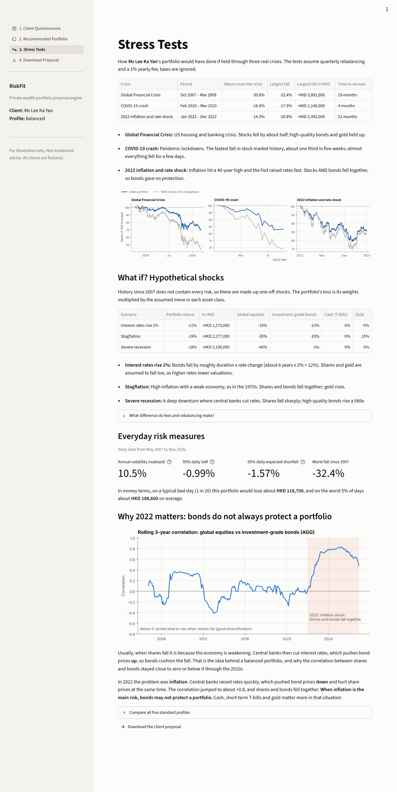
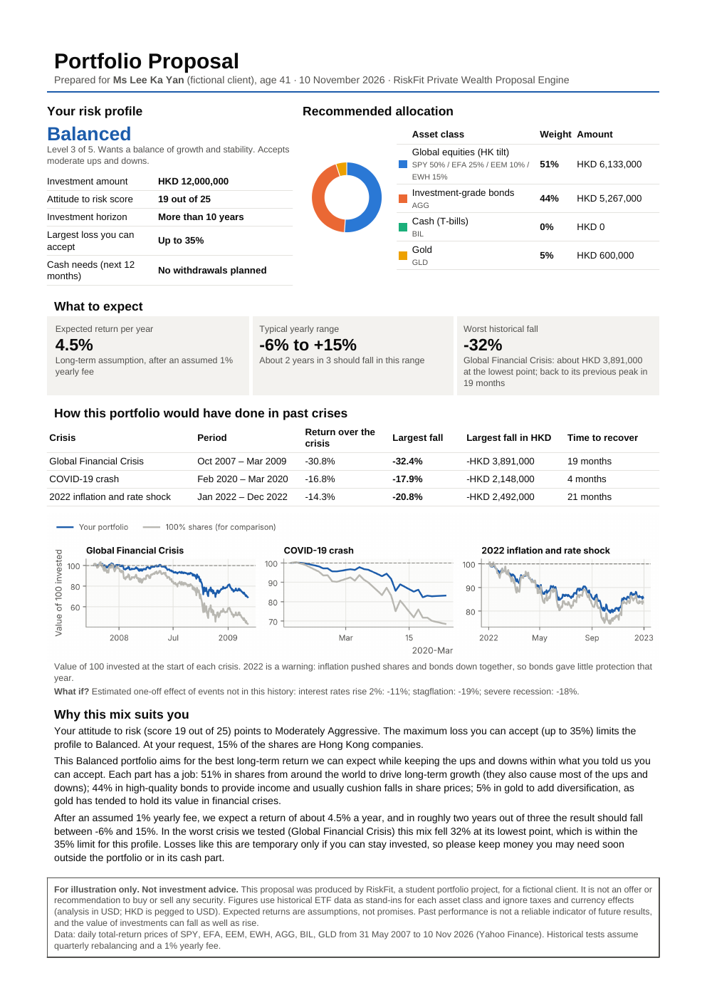
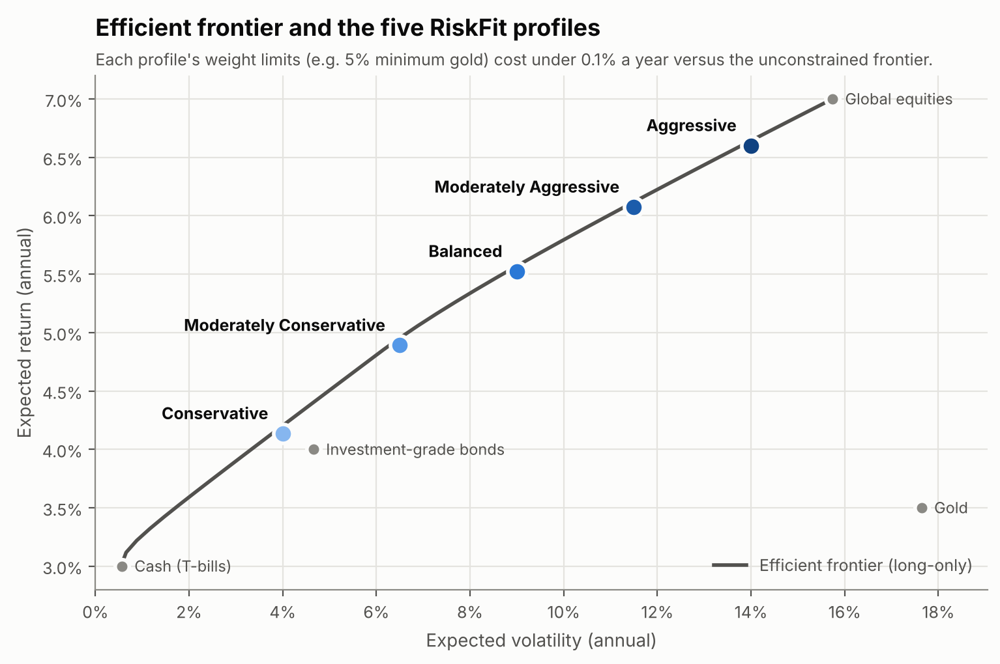
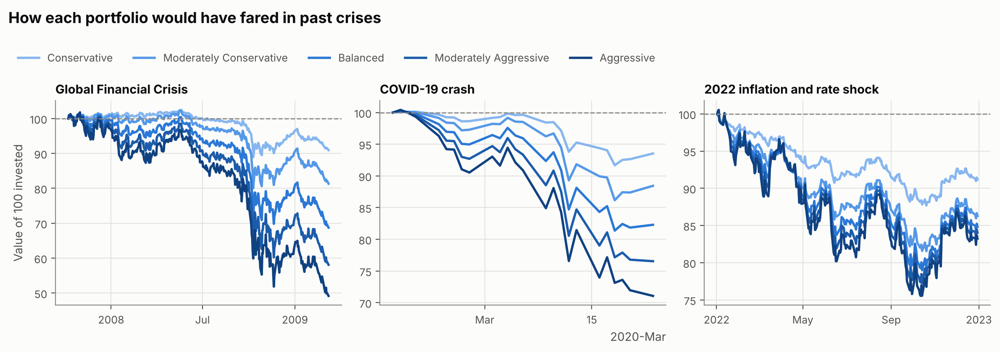
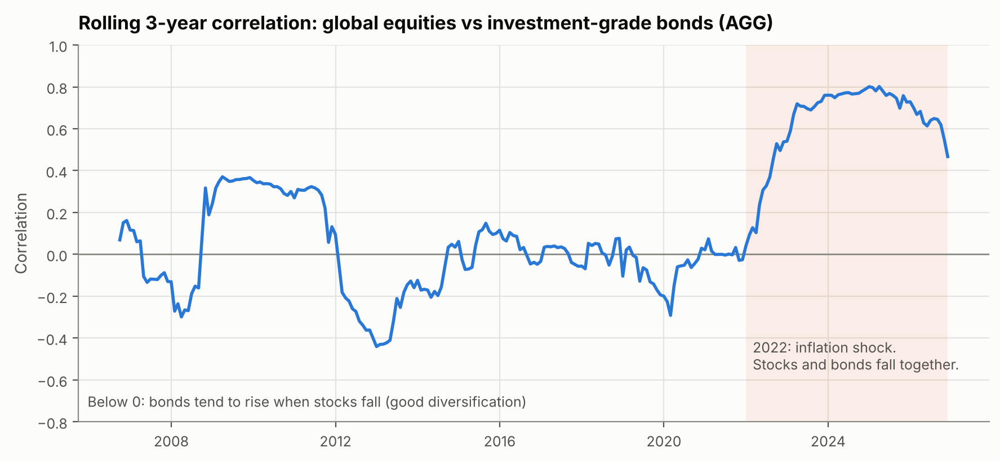

# RiskFit — Private Wealth Portfolio Proposal Engine

RiskFit is a tool a relationship manager could use to turn a client's risk-profiling questionnaire into an
investment proposal. It scores the client into one of five risk profiles, separating their **willingness**
to take risk (attitude) from their **ability** to take risk (horizon and maximum loss). It then builds a
portfolio of global equities, investment-grade bonds, cash and gold using **constrained mean-variance
optimisation** with Ledoit-Wolf shrinkage. It **stress-tests** that portfolio against the 2008 Global
Financial Crisis, the 2020 COVID crash and the 2022 inflation shock, after fees, and against hypothetical
"what if" shocks. Finally, it produces a **one-page PDF proposal** written for a non-expert client, in USD or
HKD. Everything runs in a four-page Streamlit app on free daily ETF data from 2007 to 2026.

> **For illustration only. Not investment advice.** This is a student portfolio project. All clients are fictional.



| Client questionnaire | Stress tests | One-page PDF proposal |
|---|---|---|
|  |  |  |

Sample PDFs for three fictional clients are in [`examples/`](examples/).

---

## How it works

```
Questionnaire ─► Risk profile ─► Optimised portfolio ─► Stress tests ─► PDF proposal
 (5 + 3 questions)  (1 of 5 levels)  (SciPy SLSQP)          (2008 / 2020 / 2022)  (reportlab)
```

1. **Client Questionnaire.** Five attitude-to-risk questions (goal, experience, reaction to a 20% fall,
   preferred range of outcomes, comfort with swings), plus investment horizon, maximum acceptable loss
   and liquidity needs. Amounts can be shown in USD or HKD, and the equity part can take a Hong Kong tilt.
2. **Recommended Portfolio.** The optimised allocation, the efficient frontier with the client marked on
   it, and a plain-English explanation of why the mix suits them.
3. **Stress Tests.** Return, maximum drawdown and recovery time in each crisis after fees, three
   hypothetical shocks, volatility, historical VaR and expected shortfall, and the rolling stock–bond
   correlation.
4. **Download Proposal.** A one-page PDF with the client's profile, allocation chart, expected return and
   range, worst historical loss in USD, a plain-English explanation and a clear disclaimer.

## How to run

You need Python 3.10 or newer.

```bash
git clone https://github.com/HxCSYxC/riskfit-portfolio-advisor.git
cd riskfit-portfolio-advisor
pip install -r requirements.txt

streamlit run app/streamlit_app.py      # the app, at http://localhost:8501
pytest                                  # 112 tests
```

The price data is already cached in `riskfit/data/cache/prices.csv`, so the app works offline. Other commands:

```bash
python -m riskfit.data.loader --refresh     # download fresh prices from Yahoo Finance
python -m riskfit.optimiser.frontier        # print profile portfolios, save the frontier chart
python -m riskfit.stress_test.scenarios     # print stress-test tables, save the charts
python -m riskfit.optimiser.sensitivity     # how the weights react to the return assumptions
python scripts/generate_examples.py         # rebuild the three example PDFs
```

---

## Methodology

### Data and asset proxies

All data is daily, from Yahoo Finance via `yfinance`. Prices are **adjusted** for dividends and coupons,
so returns are total returns.

| Asset class | ETF proxy | Data from | Why this proxy |
|---|---|---|---|
| Global equities | SPY 60% / EFA 30% / EEM 10% | Apr 2003 | A fixed blend of US, other developed and emerging markets, close to a global index's regional weights. Global ETFs (ACWI, VT) only start in 2008, too late for the GFC. |
| Investment-grade bonds | AGG | Sep 2003 | Whole US investment-grade market (Treasuries, corporates, MBS). A Treasury-only fund (IEF) would flatter 2008. |
| Cash | BIL | May 2007 | 1–3 month T-bills. The closest ETF to cash with history before the GFC. |
| Gold | GLD | Nov 2004 | Physically backed gold. |

The four-asset sample runs from **30 May 2007 to 10 Nov 2026** (4,895 trading days).

### Hong Kong options

- **HKD display.** A client's amounts can be shown in HKD. The analysis itself runs in USD. HKD is
  pegged to the USD in a 7.75–7.85 band, so percentage results are the same to within the width of
  the band (about 1.3%).
- **Hong Kong tilt.** The equity part can be switched to SPY 50% / EFA 25% / EEM 10% / EWH 15%, for
  clients who want some home-market exposure. EWH (MSCI Hong Kong) is USD-listed, so it shares a
  trading calendar with the other ETFs. Results barely change: the Balanced portfolio's worst fall is
  −32.4% with the tilt against −32.3% without.
- **Link to Hong Kong suitability rules.** The questionnaire is a simplified illustration of the
  information the SFC's Code of Conduct expects an adviser to gather and use. Paragraph 5.1 ("know your
  client") covers the client's financial situation, investment experience and investment objectives.
  Paragraph 5.2 requires a recommendation to be reasonably suitable for that client. The SFC's suitability
  guidance lists investment objectives, investment horizon, knowledge and experience, risk tolerance and
  financial situation as the factors. RiskFit asks about each of these except the full financial
  situation, which is a stated limitation. It is not a compliance tool.

### Risk profiling: willingness vs ability

- **Attitude to risk:** five questions scored 1–5 points each (total 5–25), mapped to levels 1–5.
- **Ability to take risk:** the investment horizon and the maximum acceptable loss each set a **cap** on
  the level (e.g. a 1–3 year horizon caps the client at level 2).
- **Final profile = the lowest of the three.** A client who *wants* high risk but needs the money soon
  gets a cautious profile, and the proposal explains why.
- **Liquidity needs** don't lower the profile. They set a **minimum cash holding** (10% or 20%).

The maximum-loss bands (15% / 25% / 35% / 45% / more) were **calibrated against the stress tests**, so
every profile's worst historical drawdown stays within the loss the client said they could accept. A unit
test re-checks this on the real data, for both equity mixes, after fees.

### Portfolio construction

For each profile, the optimiser **maximises expected return** subject to:
- **volatility ≤ the profile's target** (4% / 6.5% / 9% / 11.5% / 14%);
- weights adding up to 100%, with no short selling;
- **minimum and maximum weights per asset**, including a 5% minimum in gold and the liquidity cash floor.

It is solved with SciPy's SLSQP.

- **Expected returns are forward-looking "building blocks", not historical averages:**
  - cash 3.0%;
  - bonds 4.0% (cash + 1% term/credit premium);
  - equities 7.0% (cash + 4% equity risk premium);
  - gold 3.5% (inflation + 1%).

  From 2007 to 2026, global equities returned about 8% a year and gold about 9%. Feeding those numbers
  into an optimiser would make it chase past winners. The proposal shows expected returns **after an
  assumed 1% yearly fee**.
- **Covariance** comes from monthly returns with **Ledoit-Wolf shrinkage applied to the correlations**
  (shrinkage intensity 0.23). Each asset keeps its measured volatility. The standard version would pull
  cash's 0.6% volatility up towards the average.
- **The 5% gold floor is a deliberate policy choice.** With a conservative return assumption, pure
  mean-variance holds no gold. The floor costs under 0.1% a year of expected return and reduced
  drawdowns by 0.3–0.8 percentage points in 2008 and 2022.



### Stress tests and risk measures

| Scenario | Window | What happened |
|---|---|---|
| Global Financial Crisis | 9 Oct 2007 – 9 Mar 2009 | Global equities −56%; bonds +7%, gold +25% |
| COVID-19 crash | 19 Feb – 23 Mar 2020 | Global equities −33% in five weeks |
| 2022 inflation and rate shock | calendar 2022 | Global equities −17% **and** bonds −13% |

For each scenario, RiskFit reports:
- **return over the window**;
- **maximum drawdown**, the worst peak-to-trough fall;
- **recovery time**, from the trough until the portfolio is back at its pre-crisis peak, using the data after the crisis.

**Costs.** The tests assume a **1% yearly fee** and **quarterly rebalancing**: weights drift with the
markets and are reset on the first trading day of each quarter. The app also shows the results with no
fee and daily rebalancing, for comparison.

**Hypothetical shocks** cover risks the 2007–2026 history does not contain. Each is a one-off move in
every asset class at once, and the portfolio's loss is its weights times those moves:

| Shock | Equities | Bonds | Cash | Gold |
|---|---|---|---|---|
| Interest rates rise 2% | −10% | −12% (about 6 years' duration × 2%) | 0% | −5% |
| Stagflation | −30% | −10% | 0% | +15% |
| Severe recession | −40% | +5% | 0% | 0% |

The shock sizes are judgement calls, written down in `riskfit/stress_test/hypothetical.py`.

Full-period measures:
- annualised volatility;
- **historical 95% VaR and expected shortfall**, from actual daily returns, so fat tails are included;
- the **rolling 3-year stock–bond correlation**.

---

## Key results

**The five profile portfolios** (global equity mix, no liquidity needs):

| Profile | Equities | Bonds | Cash | Gold | Exp. return before fees | After 1% fee | Exp. volatility |
|---|---|---|---|---|---|---|---|
| Conservative | 17% | 41% | 36% | 5% | 4.1% | 3.1% | 4.0% |
| Moderately Conservative | 32% | 58% | 5% | 5% | 4.9% | 3.9% | 6.5% |
| Balanced | 52% | 43% | 0% | 5% | 5.5% | 4.5% | 9.0% |
| Moderately Aggressive | 70% | 25% | 0% | 5% | 6.1% | 5.1% | 11.5% |
| Aggressive | 88% | 8% | 0% | 5% | 6.6% | 5.6% | 14.0% |

Weights are rounded, so a row may not add up to exactly 100%.

**How they would have done in past crises** (maximum drawdown after a 1% fee with quarterly rebalancing,
recovery time in brackets):

| Profile | 2008 GFC | 2020 COVID | 2022 inflation | 95% daily VaR | 95% daily ES |
|---|---|---|---|---|---|
| Conservative | −13.2% (12 months) | −8.4% (2 months) | −12.3% (19 months) | −0.40% | −0.63% |
| Moderately Conservative | −21.7% (14 months) | −14.0% (3 months) | −18.5% (21 months) | −0.68% | −1.06% |
| Balanced | −32.3% (19 months) | −18.8% (3 months) | −21.0% (19 months) | −0.96% | −1.60% |
| Moderately Aggressive | −42.9% (25 months) | −23.7% (4 months) | −23.0% (16 months) | −1.29% | −2.15% |
| Aggressive | −51.7% (46 months) | −29.2% (4 months) | −24.9% (16 months) | −1.62% | −2.70% |



**Hypothetical shocks** (one-off portfolio return):

| Profile | Rates rise 2% | Stagflation | Severe recession |
|---|---|---|---|
| Conservative | −7.0% | −8.6% | −4.9% |
| Moderately Conservative | −10.4% | −14.7% | −10.0% |
| Balanced | −10.6% | −19.1% | −18.5% |
| Moderately Aggressive | −10.3% | −22.7% | −26.7% |
| Aggressive | −9.9% | −26.3% | −34.6% |

**What stands out:**

- **2008 rewarded diversification; 2022 did not.** In the GFC the gap between Conservative (−13%) and
  Aggressive (−52%) was huge, because bonds and gold rose while stocks fell. In 2022 the gap shrank to
  −12% vs −25%, and the Balanced portfolio lost *more* than in the COVID crash (−21.0% vs −18.8%),
  even though stocks fell far less.
- **Why: bonds don't always protect a portfolio when inflation is the main risk.** Normally, falling
  stocks mean a weaker economy, rate cuts and *rising* bond prices. In 2022, inflation forced rapid rate
  *rises*, which hit bonds and stocks at the same time. The rolling 3-year stock–bond correlation stayed
  between about −0.4 and +0.2 from 2012 to 2021, then rose to about **+0.8** after 2022.
- **A rate shock hits every profile about equally.** In the "rates rise 2%" shock, four of the five
  profiles lose about 10%, because bonds fall more than shares. Holding more bonds does not make a
  portfolio safer against that risk; only cash does.
- **Fees and realistic rebalancing make recoveries much slower.** With no fee and daily rebalancing, the
  Aggressive portfolio recovered from 2008 in 26 months. With a 1% fee and quarterly rebalancing it took
  46 months. The falls themselves are at most about 1.5 percentage points deeper.
- **The mix is robust to the equity return assumption.** Changing the equity risk premium from 3% to 5%
  leaves the Balanced, Moderately Aggressive and Aggressive weights unchanged, because the volatility
  target decides the mix. The split between bonds and cash in the two cautious profiles is the
  sensitive part: with a bond premium of 0.5% instead of 1%, Moderately Conservative moves from 58% bonds
  and 5% cash to 25% bonds and 32% cash.
- **The stress tests changed the questionnaire.** The first version allowed a client who accepts "up to 5%
  loss" into a portfolio that fell 12% in 2008. The loss bands were recalibrated so that no proposal
  promises a loss limit its portfolio has already broken.



---

## Limitations

- **History is a limited guide.** About 19 years of ETF data cover only three major crises. The
  hypothetical shocks help, but their sizes are judgement calls, and the tested weights were chosen
  *after* the historical events.
- **ETF proxies.** The equity blend uses fixed regional weights, while a real global index changes its
  weights over time. AGG and BIL are US instruments, so bonds and cash carry no Asian exposure.
- **Simple costs.** One flat 1% fee stands in for advisory fees, fund costs and trading spreads. Taxes
  are ignored.
- **Currency.** The analysis is in USD. HKD amounts rely on the peg holding, and clients spending in
  other currencies would need a different analysis.
- **Assumption-driven.** Expected returns are judgement-based capital market assumptions. The
  sensitivity table shows the bond and cash split depends on them. Volatility is estimated from monthly
  data, which understates daily volatility (e.g. 14% target vs 17.7% realised for Aggressive). The app
  shows both.
- **Simplified suitability.** A real assessment covers the client's whole financial situation, existing
  holdings, concentration, knowledge of products and regulatory requirements. Here it is eight questions
  and one pot of money.
- **Four asset classes only.** No high yield, private markets or alternatives.

---

## Project structure

```
riskfit/
  config.py                    # asset classes, ETF blends, costs, paths
  data/loader.py               # download, clean, cache prices; blended equity index; returns
  risk_profile/questionnaire.py  # questions, scoring, willingness vs ability
  risk_profile/profiles.py     # 5 profiles: volatility target, loss limit, weight limits
  optimiser/assumptions.py     # building-block expected returns
  optimiser/mean_variance.py   # Ledoit-Wolf covariance, constrained optimisation
  optimiser/frontier.py        # efficient frontier
  optimiser/sensitivity.py     # weights under different return assumptions
  stress_test/metrics.py       # rebalancing and fees, drawdown, recovery, VaR, ES, correlation
  stress_test/scenarios.py     # 2008 / 2020 / 2022 scenarios
  stress_test/hypothetical.py  # "what if" shocks
  proposal.py                  # questionnaire -> portfolio -> stress tests -> explanation
  report/charts.py             # matplotlib charts used by the app, PDF and README
  report/pdf.py                # one-page reportlab proposal
app/                           # Streamlit app (4 pages)
examples/                      # 3 fictional clients (.json) and their PDFs
scripts/generate_examples.py
tests/                         # 112 pytest tests
LEARNING.md                    # plain-English explanation of every part, with interview Q&A
```

**Tests** cover:
- the scoring rules (band edges, capacity caps, liquidity);
- the optimiser constraints (weights sum to 1, limits respected, volatility target met, cash floor);
- the stress-test maths (drawdown, recovery, VaR/ES, weight drift, fees and shocks on hand-checked examples);
- the equity blend and the sensitivity cases;
- a calibration check on real data, for both equity mixes;
- the PDF (exactly one page, key content present);
- a smoke test of every app page.

---

*Built by [Henry Chan](https://github.com/HxCSYxC), a Year 3 Decision Analytics student at HKUST, as a
portfolio project for private wealth management. It uses Python, pandas, SciPy, scikit-learn, matplotlib,
reportlab and Streamlit.*
